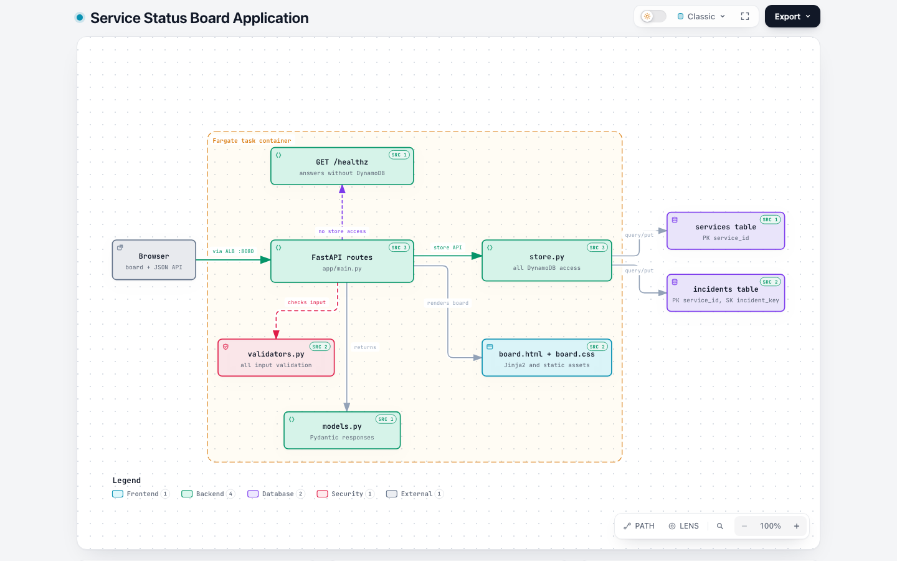

# status-board-app

A small internal **Service Status Board**: the current health of a handful of
services, and the incident history behind each one.

This application is a test workload for the `ai-tokenomics` toolkit. AI
coding agents work on it, and the toolkit measures the cost. It is deliberately
small enough to read on screen. It is not a production system.

- **Stack:** Python, FastAPI, DynamoDB, served from a container
- **Infrastructure:** the companion `tokenomics-status-board-infra` repository
- **Source:** the `ai-tokenomics` toolkit repository, under `workloads/`

## How it fits together

<picture>
  <source media="(prefers-color-scheme: dark)" srcset="docs/architecture.dark.png">
  
</picture>

Two house rules are visible in the shape of it: request input reaches the application only
through `validators.py`, and DynamoDB is reached only through `store.py`. `GET /healthz`
deliberately touches neither, so a failing health check can only mean the load balancer
cannot reach the container.

## Quick start

```bash
python3 -m venv venv
./venv/bin/pip install -r requirements-dev.txt
./venv/bin/python -m pytest
```

To run the board locally with Docker:

```bash
docker compose up --build -d
./venv/bin/python -m scripts.create_tables
./venv/bin/python -m scripts.seed
```

The board is then at <http://localhost:8080>.

See [AGENTS.md](AGENTS.md) for the layout, how to run it locally, the
configuration it reads, and the conventions every change is held to.

## Deployment

[`.github/workflows/deploy.yml`](.github/workflows/deploy.yml) runs the tests on
every pull request. On `main` it also builds the image on Graviton, pushes it to
ECR, rolls the ECS service onto it, seeds the board, and checks that the board
answers. Credentials come from GitHub OIDC; there is no access key.

[`.github/workflows/check-aws-access.yml`](.github/workflows/check-aws-access.yml)
shows the OIDC subject claim, assumes the deployment role, and checks ECR
access. It changes nothing. Run it after setup, or when a deployment fails
with `AccessDenied`.

The workflows read these repository variables. The toolkit script
`setup/configure-repos.sh` sets them from the infrastructure bootstrap outputs.

| Variable | Example | Purpose |
|---|---|---|
| `AWS_REGION` | `us-east-1` | Region of the stack |
| `AWS_ROLE_ARN` | `arn:aws:iam::<account>:role/tokenomics-status-board-app-deploy` | Role the workflow assumes |
| `NAME_PREFIX` | `tokenomics-status-board` | Name of the ECR repository, cluster, service, and task family; prefix of the tables |
| `BOARD_URL` | `https://tokenomics.awsf.brightkey.cloud` | Address the workflow checks after a deployment |
