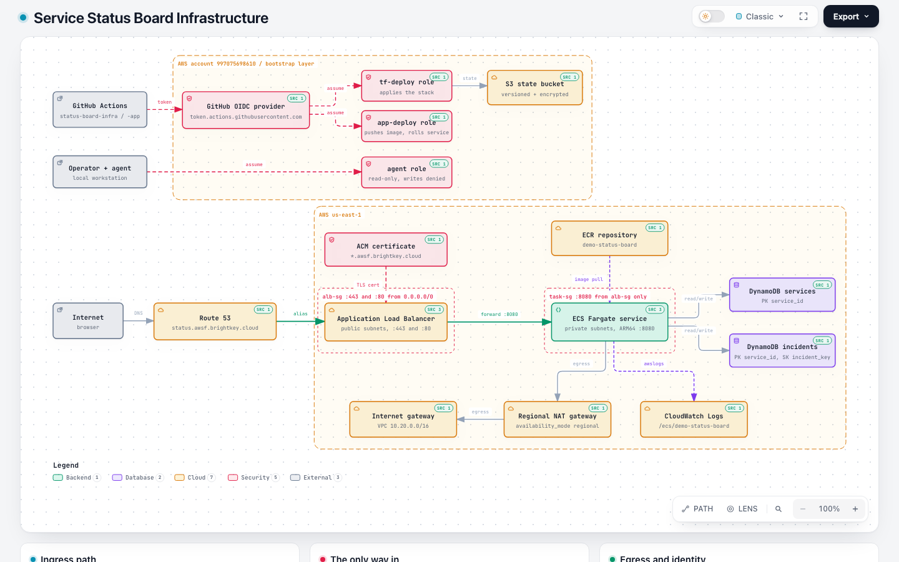

# status-board-infra

AWS infrastructure for the **Service Status Board**, the application used in
the video course *Tokenomics: Managing AI Agent Costs*.

- **Application:** the companion `tokenomics-status-board-app` repository
- **Course material:** the `ai-tokenomics` repository, under `workloads/`

This is teaching material, not a production system.

## What gets built

<picture>
  <source media="(prefers-color-scheme: dark)" srcset="docs/architecture.dark.png">
  
</picture>

Outbound traffic uses a **regional** NAT gateway: a single gateway that spans
the Availability Zones and manages its own addresses, rather than one zonal
gateway per zone. It needs no subnet of its own, and it costs one gateway-hour
instead of one per zone.

The application writes its logs to the CloudWatch log group
`/ecs/<name prefix>`. The course uses that log group in demo 5.2.

## Two layers, and why

| Layer | State | Applied by | Holds |
|---|---|---|---|
| `bootstrap/` | `s3://.../bootstrap.tfstate` | You, once, from your laptop | GitHub OIDC provider, three IAM roles |
| `terraform/` | `s3://.../terraform.tfstate` | GitHub Actions, via OIDC | The stack in the diagram above |

`bootstrap/` exists to break a circular dependency: GitHub Actions cannot
deploy until the OIDC provider and its role exist. Both layers keep their
state in the same S3 bucket under different keys, with the S3 native lock
file rather than a DynamoDB lock table.

The bucket itself is created by `bootstrap/create-state-bucket.sh` and is
**deliberately not managed by Terraform**. A layer that manages the bucket
holding its own state cannot be destroyed cleanly, because the bucket
disappears while Terraform is still writing to it. The script is idempotent,
so running it again on an existing bucket is safe. It also writes
`backend.hcl` in both layers, which holds the bucket name and region for
`terraform init`. That file is not committed.

### The three roles

| Role | Assumed by | May do |
|---|---|---|
| `<prefix>-tf-deploy` | Workflows in this repository | Deploy the stack. IAM limited to roles named `<prefix>-*` |
| `<prefix>-app-deploy` | Workflows in the application repository | Push to one ECR repository and roll the service forward. Nothing else |
| `<prefix>-agent` | You or an agent, locally | Read CloudWatch logs and metrics, CloudTrail, Config, and resource state. The writes most likely to change the environment are explicitly denied, and anything else not listed is refused because it is never allowed |

The default prefix is `tokenomics-status-board`. Each deployment role trusts
**only** its own repository, on `main` or a pull request. No access key is
ever created.

## Settings you can change

| Setting | Default | Where to change it |
|---|---|---|
| Hosted zone | `awsf.brightkey.cloud` | `hosted_zone_name` in both layers; repository variable `HOSTED_ZONE_NAME` |
| Board label | `tokenomics` (so `tokenomics.<zone>`) | `subdomain`; repository variable `SUBDOMAIN` |
| ACM certificate | Primary name equal to the zone, with a wildcard name | `certificate_domain`; repository variable `CERTIFICATE_DOMAIN` |
| Name prefix | `tokenomics-status-board` | `env` and `service` in both layers; repository variable `ENV_NAME` |
| Region | `us-east-1` | `region`; repository variable `AWS_REGION` |
| OIDC provider | Created | `create_github_oidc_provider = false` if the account already has one |

You need a public Route 53 hosted zone and an ISSUED ACM certificate for the
board name in the same region, before you apply `terraform/`.

## Bringing it up

The course repository automates steps 1 and 3. See `setup/` in
`ai-tokenomics`. By hand:

```bash
# 1. One time only, with your own credentials. Creates the state bucket with
#    versioning, encryption and public access blocked, and writes backend.hcl
#    in both layers. Safe to re-run.
./bootstrap/create-state-bucket.sh

# 2. The OIDC provider and the three roles. terraform.tfvars needs your
#    GitHub owner and repository ids; see terraform.tfvars.example.
cd bootstrap
terraform init -backend-config=backend.hcl
terraform apply

# 3. Set the repository variables in both repositories from the outputs:
#    AWS_REGION, AWS_ROLE_ARN, TF_STATE_BUCKET, NAME_PREFIX, BOARD_URL.

# 4. Check the connection: run the check-aws-access workflow. It shows the
#    OIDC subject claim, assumes the role, and runs a read-only plan.
#    Compare the claim with: terraform -chdir=bootstrap output oidc_subjects

# 5. The stack itself, from GitHub Actions: run the terraform workflow.
#    To run it by hand instead:
cd ../terraform
terraform init -backend-config=backend.hcl
terraform apply

# 6. Deploy the application: run the deploy workflow in the application repository.
```

The ECS service has no image to pull until the application repository
publishes one, so it restarts until that first deployment lands. That is
expected on a fresh build.

## Tearing it down

Always tear down after a rehearsal or a recording. The stack costs money for
every hour it exists.

```bash
# 1. The stack: run the destroy workflow with confirm=destroy, or by hand:
cd terraform
terraform destroy

# 2. Only if you are finished with the whole course. This removes the
#    OIDC provider (if this layer created it) and the roles, so step 1 must
#    come first.
cd ../bootstrap
terraform destroy
```

Both layers destroy cleanly, because neither of them owns the bucket their
state lives in. Remove the bucket last, by hand, once you no longer need the
state history. Versioning keeps old objects, so it has to be emptied first:

```bash
BUCKET=$(sed -n 's/^bucket = "\(.*\)"/\1/p' bootstrap/backend.hcl)

aws s3api delete-objects --bucket "$BUCKET" \
  --delete "$(aws s3api list-object-versions --bucket "$BUCKET" \
    --query '{Objects: Versions[].{Key:Key,VersionId:VersionId}}' --output json)"

aws s3api delete-objects --bucket "$BUCKET" \
  --delete "$(aws s3api list-object-versions --bucket "$BUCKET" \
    --query '{Objects: DeleteMarkers[].{Key:Key,VersionId:VersionId}}' --output json)"

aws s3 rb "s3://$BUCKET"
```

Confirm nothing is left behind:

```bash
PREFIX=tokenomics-status-board
aws ecs list-clusters --query "clusterArns[?contains(@,'$PREFIX')]"
aws elbv2 describe-load-balancers --query "LoadBalancers[?contains(LoadBalancerName,'$PREFIX')]"
aws ec2 describe-nat-gateways --filter Name=state,Values=available "Name=tag:Name,Values=$PREFIX*" \
  --query "NatGateways[].NatGatewayId"
aws iam list-roles --query "Roles[?starts_with(RoleName,'$PREFIX')].RoleName"
```

## What it costs

Priced in `us-east-1` from the AWS Pricing API.

| Resource | Rate | Per month |
|---|---|---|
| Regional NAT gateway | $0.045/hour | $32.85 |
| Application Load Balancer | $0.0225/hour | $16.43 |
| Fargate task, 0.25 vCPU / 0.5 GB, ARM | $0.03238/vCPU-hr + $0.00356/GB-hr | $7.21 |
| DynamoDB on demand, ECR, CloudWatch Logs | usage based | under $1 |
| **Total** | **$0.0999/hour** | **about $56.50** |

A two-day rehearsal window costs roughly **$4.80**. Data processed by the NAT
gateway adds $0.045 per GB, which is pennies at demonstration volumes.

This stack does not create AWS Config or CloudTrail resources.
